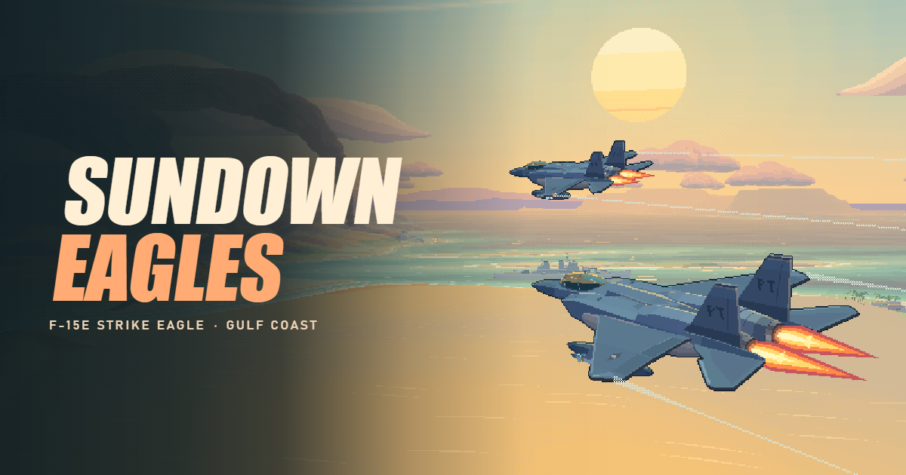
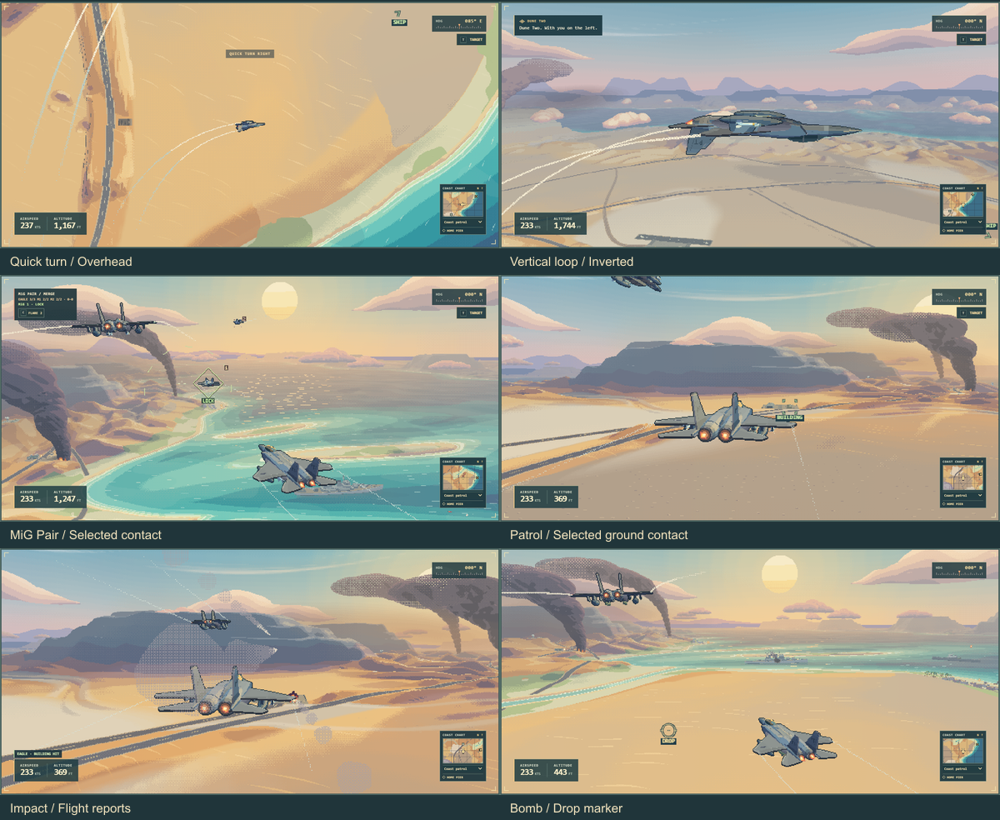

# 落日双鹰 · Sundown Eagles

**[立即试玩 · Play in your browser](https://mav-xxl.github.io/gulf-patrol/)**  ·  **[下载离线版 · Download for offline play](https://github.com/Mav-xxL/gulf-patrol/releases/latest/download/sundown-eagles.html)**

打开游戏，你和僚机已经飞在海湾上空。沿着公路压低机头，看车队扬起沙尘。飞过海岸后按下 **Q** 掉头，再从夕阳里迎面掠过。想来一场双机空战，就在 **Flight setup → Opponents** 选 **MiG pair**，按 **M** 迎战。

You start in the air with your wingman off your left wing. Follow a convoy through the dust, pull a loop over the coast, or switch to moonlight and fly by the glow of the harbor. To face two MiGs, open **Flight setup → Opponents**, select **MiG pair** and press **M**.

## 第一次试飞 · Your first flight

| 想做什么 · Action | 操作 · Controls |
| --- | --- |
| 驾驶 · Steer | 移动鼠标或用方向键 · Move the mouse or use the arrow keys |
| 横滚 / 加力 · Roll / boost | 轻点 / 按住鼠标左键 · Tap / hold the left mouse button |
| 掉头 / 翻圈 · Quick turn / vertical loop | **Q** / **E** |
| 换视角 / 调远近 · Cycle view / change distance | **Space** / 飞行区内滚轮 · Scroll over the flight view |
| 进入 / 退出空战 · Enter / leave an air duel | **M** |
| 换挂载 / 换目标 · Cycle loadout / target | **W** / **T** |
| 发射或投放 · Fire or drop | **F** 或鼠标右键 · **F** or right-click |
| 僚机发射 · Command wingman | **G** |
| 释放干扰弹 / 跟拍坠落 · Release flares / watch a falling MiG | **C** / **V** |

手机上拖动飞行画面转向，另一根手指可以点 **MOVE** 选动作，或点 **FIRE**、**DROP** 和 **TARGET**。想看清翻圈的航迹，可以把 **Camera** 换成 **Side**。

On touchscreens, drag to steer and use a second finger for the action buttons. Try the **Side** camera for a loop, then switch to **Cockpit** for your next pass.

## 离线游玩 · Offline play

下载顶部的 **sundown-eagles.html** 后用支持 WebGL2 的浏览器打开即可。也可以将本仓库下载为 ZIP，解压后打开 **index.html**。游戏的地形、飞机、像素座舱和合成音效都在这个 HTML 文件里。声音默认关闭，可点 **SOUND** 开启。

Open the downloaded **sundown-eagles.html** in a browser with WebGL2. The terrain, aircraft, cockpit and synthesized audio are all built into the file. The interface uses fonts already on your device. The setting is a fictional Gulf coast inspired by the winter of 1991.
